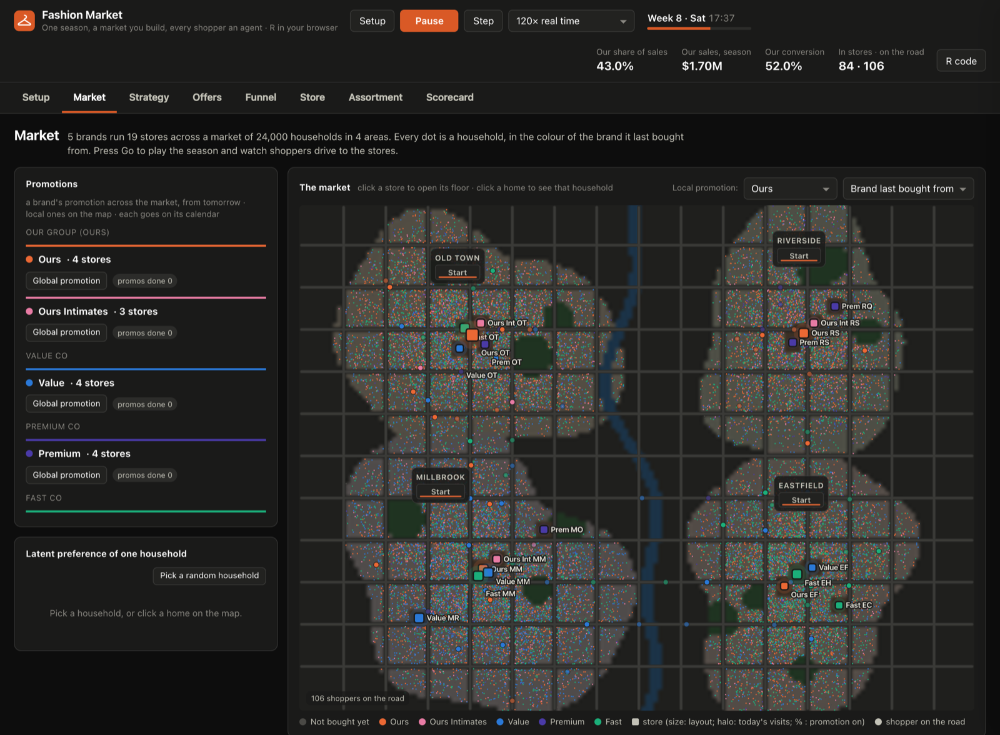
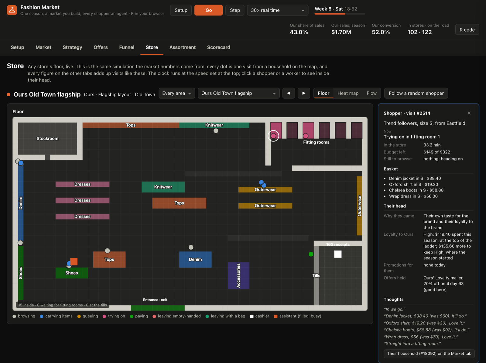
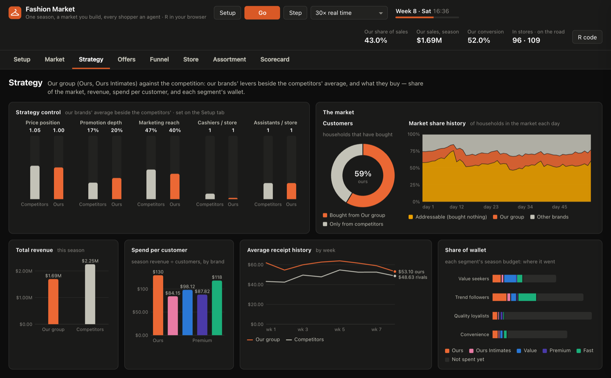
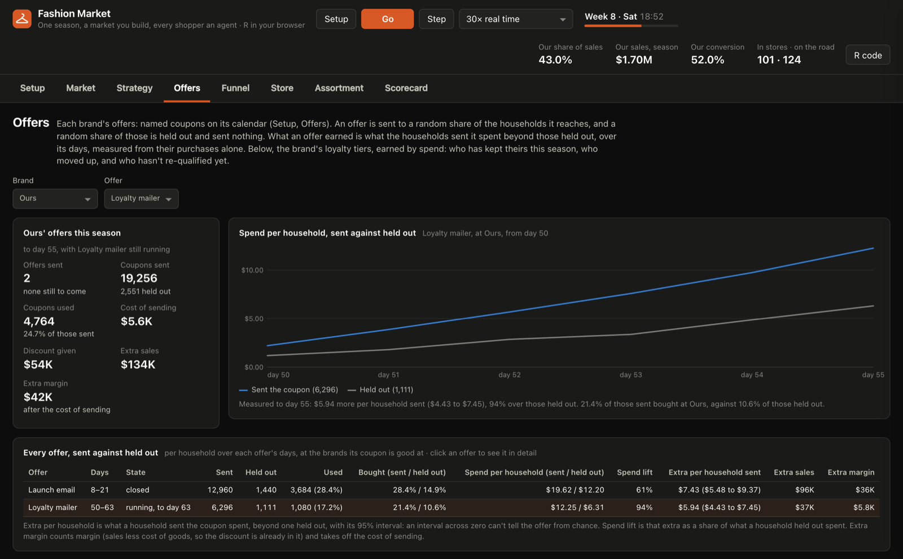
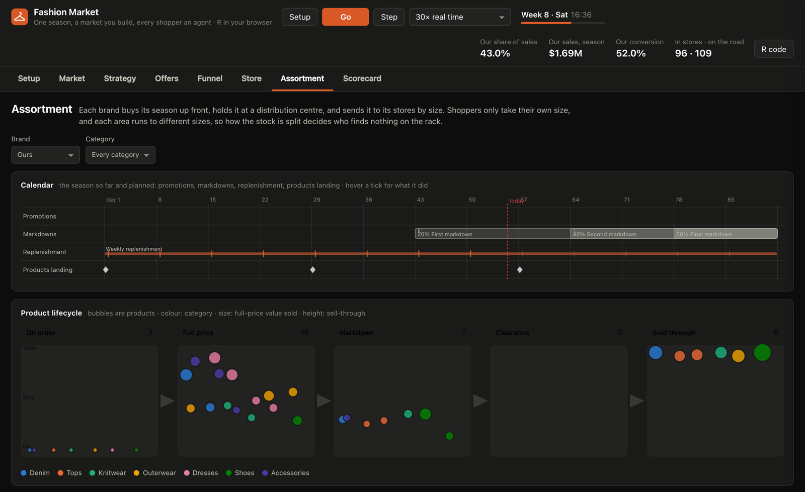
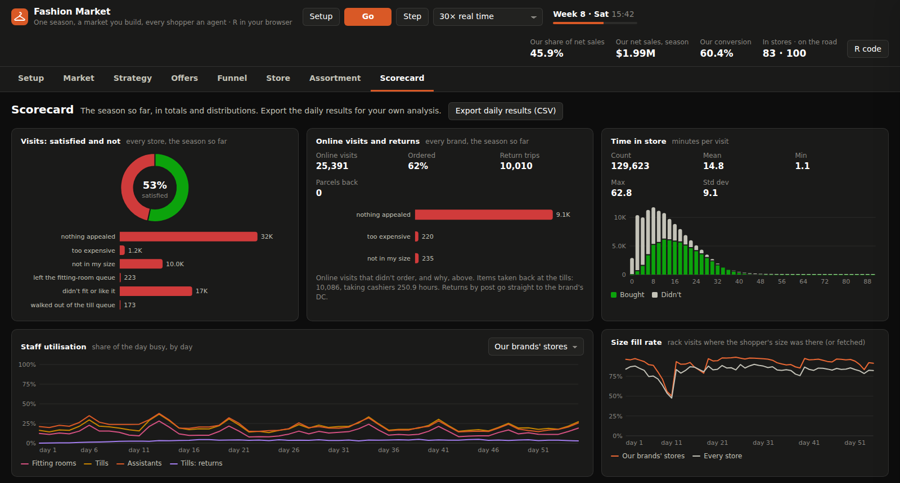
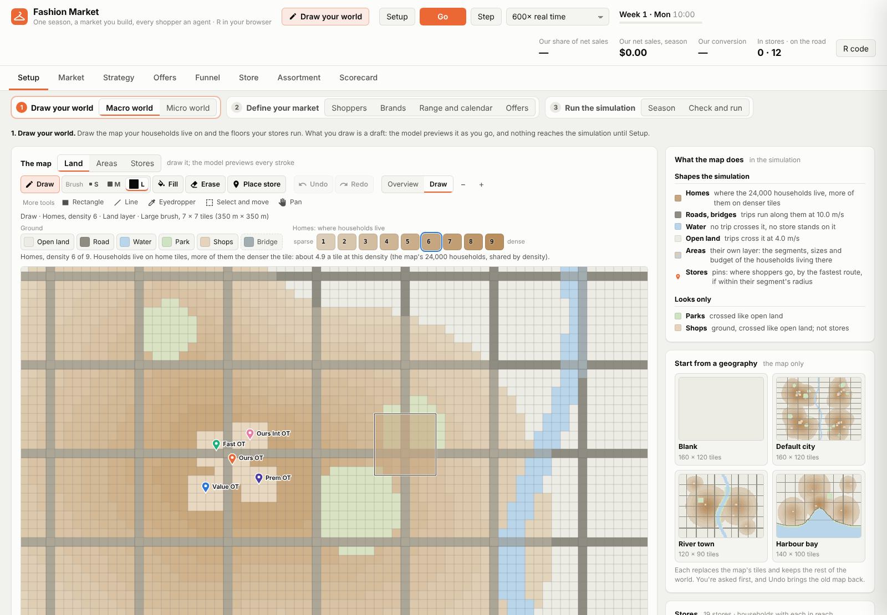
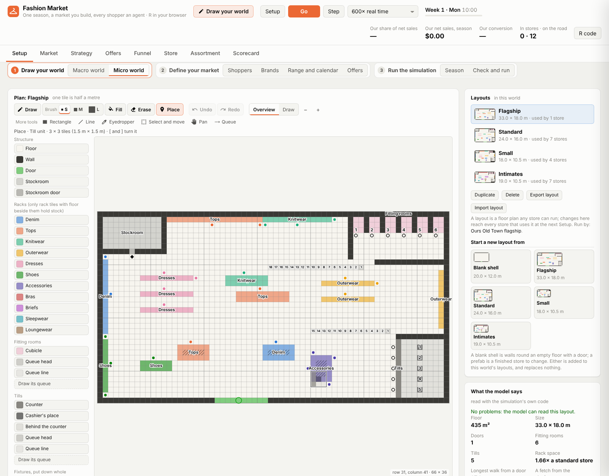
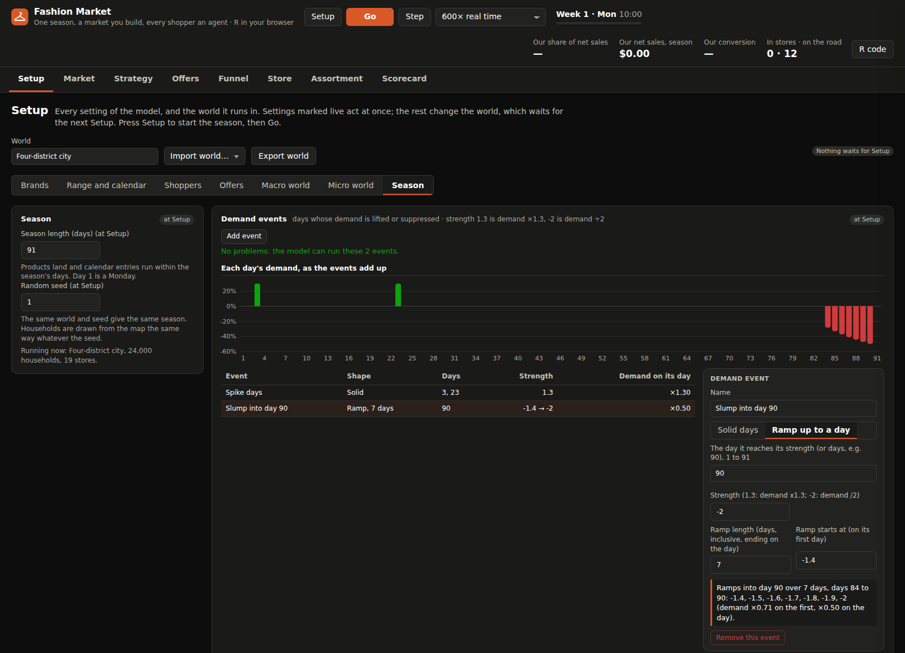

# Fashion Market

**A season of fashion retail, simulated one shopper at a time, in your browser.**

Test staffing, size allocation, replenishment, markdowns, promotions,
offers, online stores and return policies against a market you build, and
see what each is worth in net sales, margin and share.

**[Open the app](https://8139causal.github.io/fashion-market/)** · no
install, no account, no server · [What it answers](#what-it-answers) ·
[Quick start](#quick-start) · [How it works](#how-it-works) ·
[Run it locally](#run-it-locally)



Every day, each household decides whether to shop, which store to visit and
what to take off the rack. In the store, shoppers walk the floor, look for
their size, queue for fitting rooms and pay at staffed tills. Every number
on every report is a sum of those decisions, so any KPI can be followed down
to the shoppers behind it, and any shopper can be opened to see why they did
what they did.

You set the market: the brands, their ranges and calendars, the shoppers,
the city map and every store's floor plan. The same world and seed always
give the same season, so two runs differ only by what you changed.

The model is R, running in the page through
[webR](https://docs.r-wasm.org/webr/) and
[NetLogoR](https://cran.r-project.org/package=NetLogoR). The **R code**
button shows the files that are running, and the world they run in.

---

## What it answers

| Decision | The question | Change on Setup | Read on |
|---|---|---|---|
| Staffing | How many cashiers and assistants does a Saturday afternoon need? What do too few cost in walk-outs, and too many in wages? | a store's staffing, scan and try-on times, queue limits | Store, Funnel, Scorecard |
| Size allocation | How much revenue is lost because the shopper's size isn't on the rack, and how much does allocating by each store's own size mix win back? | size allocation (flat or learned), the season's buy, lead time | Assortment, Funnel |
| Replenishment | Weekly or twice a week? Top up to cover, or replace what sold? What does each cost in deliveries and leftover stock, against what it wins in sizes found? | replenishment entries on the calendar, opening allocation, lead time, logistics fees, salvage value | Assortment, Scorecard |
| Markdowns | When to mark down, how deep, and everything or only what's behind plan? Should promotions also come off marked-down prices? | markdown entries on the calendar, sell-through target, price rules | Assortment, Scorecard |
| Promotions and price | A category or the whole range? Members or everyone? One area or the whole market? Whose share does it take, and what does it do to margin? | promotions on the calendar, a brand's price change and marketing | Market, Strategy, Scorecard |
| Offers and loyalty | What did a coupon add, against the households held out, net of what came back? When it's also good at a sister brand, where does the extra spend go? Who kept their tier, who moved up, who dropped? | offers on the calendar (audience, holdout, tiers and areas reached, where it's good); each tier's starting share and qualifying spend | Offers |
| Online store and returns | Does an online store win new spend, or take it from our own stores? What do delivery days and a delivery charge do to it? Does a longer return window win more than it costs in refunds, write-offs and cashier time? | a brand's online store (on or off, delivery days, delivery charge, picking and packing, shipping, its plan), its return window and return postage; each segment's taste for shopping online and tendency to return | Market, Strategy, Funnel, Assortment, Scorecard |
| Competition | What do a rival's prices, categories and launch dates do to us? | a brand's range: products, prices, costs, the day each lands | Market, Strategy, Assortment |
| Store network | Where should the next store go? Which households have no store in reach? | where stores stand on the map, its areas, each segment's travel radius | Setup (Macro world) |
| Floor plan | What does a different layout do to queues, walks and sales? | a layout (Micro world) | Store, Scorecard |
| Conversion | Where are shoppers lost between walking in and paying, and why? | nothing: filter by brand, area, store and period | Funnel |
| Seasonal demand | What does a spike day, or a suppressed week, do to sales, stock and share? What will the rest of the season sell? | demand events on the season's calendar: solid days, or a ramp up to a day | Strategy (the forecast), Market, Scorecard |

---

## Quick start

1. **[Open the app](https://8139causal.github.io/fashion-market/).** The
   first visit downloads about 17 MB (R and the NetLogoR library), which the
   browser then caches. It opens on the default world: five brands in four
   families running 19 stores and four online stores across a city of four
   areas and 24,000 households, over a 13-week season with two demand
   events: spikes on days 3 and 23, and a slump into day 90.
2. **Press Go.** The speed menu runs store time from real time to 3,600×,
   or *Fastest*: a market day per tick, without drawing.
3. **Click any store** on the map to watch its floor, then **click a
   shopper** to see their basket, their loyalty and their thoughts.
4. **Draw your world** (in the header): paint the map's homes, roads and
   water with a brush, start from another geography, place stores, draw
   their floors. The model previews every stroke: households placed,
   stores in reach, problems on the floor where they are.
5. **Change something.** Settings marked *live* act at once, even
   mid-season. Anything that changes the world waits for **Setup**, which
   counts the changes waiting. Setup checks the world first; if anything is
   wrong, it lists every problem where it is, and the season carries on in
   the world set up before.
6. **Export world** saves the whole market as one JSON file, to share or
   import later.

---

## The tour

### Market

The whole market at once (above): households coloured by the brand they last
bought from (or by segment, offer held, or area), stores in their brand's
colour, the parking lots and garages, the malls' corridors, and everyone
outdoors: cars driving the road network, shoppers walking (from their car,
from home, from store to store, along a mall's corridors) and cars parked
(online stores aren't on the map). Below the charts, **Getting about**
counts the day's outings (by car and on foot, and how they ended), the
households in stores, the store visits (each outing's destination, and
those walked on to from another store), the purchases, and each parking
facility's spaces, cars in it now, the most at once and the cars that found
it full. Beside the map, the promotions running today,
brand by brand; each brand's calendar sets them (Setup → Range and
calendar). Below, each brand's share of net sales, its net revenue split
into its stores and online, and weekly net revenue. Click a home to see that
household's latent preference (its tier with each brand, the stores and
online stores in its reach, the offers it holds) and its ledger: every item
it has bought this season, where and for how much, and what it returned,
with gross, refunds and net by brand.

**2D or 3D.** The switch over the map shows the same market in 3D: the
world drawn on the Setup tab and installed by Setup, as low-poly scenery
(the ground in each tile's colour, roads, highways and footpaths, bridges,
houses by density in their area's colour, buildings, woodland, parks,
garages' see-through decks, each mall's plan with its roof off), the
stores in their brand's colours with today's visits as a halo, the
households in the colours the map is set to, and everyone outdoors where
the simulation has them. Drag to turn the view, right-drag (or Shift-drag)
to move it, scroll to zoom; **Reset view** goes back to the starting angle.
A click works as on the 2D map: a store opens its floor, anywhere else
picks the household nearest the point. See [The 3D views](#how-it-works).

### Store



Any store's floor, live, as the floor, a footfall heat map or the process
flow with counts. Click a shopper to see what they're doing, their basket
and patience, why they came, their tier with the brand, the promotions and
offers that reach them, their household's ledger, and their visit in the
first person. Each thought's tone comes from how close the decision was;
hover over it for the numbers behind it. Shoppers bringing items back go
straight to the tills. Click a cashier or an assistant to see their work
(a cashier's includes the returns they took back), or follow a random
shopper through their visit. The store's sales are shown gross and net of
the day's refunds.

The floor and its heat map can also be shown in 3D (the switch over the
floor): the installed layout's walls cut away low, its entrances, racks in
their category's colour, the stockroom and its door, the till counter and
the cashiers' places, the fitting cubicles (lit when in use, grey when
closed) and the queues, with everyone in the store where the simulation
has them, shoppers coloured by what they're doing and staff filled when
busy. A click on a shopper or a worker in 3D opens the inspector as a
click on the 2D floor does.

### Strategy



Our family against the competition: our levers beside the competitors'
average, market share over time (addressable, ours, other brands), revenue,
spend per customer, average receipt by week, and each segment's share of
wallet, all net of refunds. A table by brand gives its gross sales,
refunds and net sales, its online share of net sales, and its return
rate. Below it, a forecast of daily net sales to the season's end, for
our family, the whole market or one brand: a seasonal ARIMA model, fitted
again as each day ends, with the season's demand events built in. It
draws the days run, the forecast's median from the next day on, its 80%
and 95% prediction intervals, and the days an event touches; it names
the model, how much sales moved with the events, and what the season
comes to. It starts once three weeks have run.

### Offers



Every offer measured against a random holdout: spend per household sent
against held out, day by day; each offer's lift with its 95% interval, its
extra sales, and its extra margin after the cost of sending; the extra spend
by tier; and where it came from (the brand, the other brands its coupon is
good at, its sister brands, its competitors, and the net for our family).
Every figure is net of returns: an item bought during the offer and returned
later, even after the offer has ended, comes off its spend and its margin
(the cost of goods comes back too, less the share written off). Below, the
loyalty tiers: who kept theirs, who moved up, and who hasn't re-qualified
yet.

### Assortment



Each brand's calendar, as run and as planned: promotions; markdowns, each
past day saying how many products it took and why it left the others;
replenishment, each order with the units sent and the day they arrive; and
products landing. Below it, products through their lifecycle (on order, full
price, markdown, clearance, sold through), sizes on the floor, sell-through
(net of returns) against weeks of cover, where the stock is (returned units
back in stock, written off, or still with shoppers who can return them), and
a product table with each product's online sales, returns, return rate and
refunds.

### Scorecard



Satisfied and unsatisfied visits and why, online visits and why they didn't
order, returns, time in store, staff utilisation (the tills' time on returns
apart), the size fill rate, each brand's path from full-price value to
contribution (markdowns and promotions, refunds, cost of goods net of
returns, returns written off at cost, staff, marketing, offers, logistics,
online picking, packing and shipping, delivery charges, return postage, and
stock written down at the season's end), and a CSV export of the daily
results: gross sales, returns (units and value), net sales, each split by
channel, and every cost.

### Funnel

In market → visited → picked items → past the fitting rooms → kept → paid,
with each stage's losses by reason (stayed home, went to another store,
nothing appealed, too expensive, not in my size, didn't fit or like it, a
queue too long), a dot for each shopper at each stage right now, and the assistant and
cashier teams. Filter by brand, area, store, period and channel: online,
the funnel is in market → visited online → ordered. After paid, a
returns step: the items bought, and of them those kept, still returnable,
on the way, and returned, by reason. It doesn't change the visit's
stages.

---

## Build your market

Everything is set on the **Setup** tab, set out as three stages: **Draw
your world** (the Macro and Micro world), **Define your market** (Shoppers,
Brands, Range and calendar, Offers) and **Run the simulation** (Season, and
Check and run). Every section is one click away at any time, and none has
to be finished first. **Draw your world**, in the header, opens the map.

### Draw your world

The map and the floors are drawn on one canvas with the same tools: **Draw**
with a brush of 1, 3 × 3 or 7 × 7 tiles (`[` and `]` change it; the brush's
whole footprint shows before it paints, and a stroke paints every tile it
crosses, however fast it's drawn), **Fill**, **Erase**, **Place** (a store
on the map, a fitting room or till unit on a floor), **Undo** and **Redo**,
one step for each drag. Rectangle, line, eyedropper, select and move, pan
and the queue tool sit in the row below. One click switches between the
**Overview**, the whole map or floor, and the **Draw** view, tiles big
enough to paint one by one (16 px, 20 for a finger) where you were working.
A line under the tools says what a press would do: the tile, the layer and
the brush's footprint in tiles and metres. Zoom and pan never change the
grid or what a tile stands for. On a phone or tablet one finger draws and
two move and zoom the view, and Undo, Redo and the view stay on the
canvas's corner.



On the **map**, every tile is named, with what it does in the model: who
can cross it, cars or people, both or neither (the table under
[Getting about](#getting-about-roads-paths-parking-and-venues)). Ground
(open land, parks, woodland, water, buildings), streets for cars and people,
highways, crossings and driveways, footpaths and pedestrian streets for
people only, the ground of parking lots, garages and malls, and homes (a
ramp from sparse to dense, with how many households a tile of each density
holds). A street painted over water is a bridge, a footpath a footbridge. Stores are pins in their
brand's colour, apart from the shops tiles under them. Areas are painted on
their own layer: a new one comes with the large brush, its name shows on
the map, and the households, budget and segment and size mix of whoever
lives on it are set beside the map. Under the map, three chips tell the
**draft** (what's drawn, kept in the browser), the model's **preview** of
it (households placed, stores in reach, households with none) and the
**installed** world (what Go runs, until Setup) apart.

A map can start from a **geography**: Blank, the default city, a river
town or a harbour bay. It replaces the map's tiles, after asking, repaints
your areas onto its districts and puts your stores on its sites; nothing
else in the world changes, and Undo brings the old map back.



On a **floor**, the tiles are listed by name beside the plan; fitting rooms
and till units are put down whole and turned with `[` and `]`, and each
queue is dragged out from its head. Racks, the stockroom, the fitting rooms
and the tills are named on the plan, and every problem the model finds is
outlined on the tiles it's about. A new layout starts from a blank shell or
a copy of a prefab.

### Every section

The seven sections that set the world and the market:

- **Brands.** Families (exactly one is ours) and their brands, each with its
  price change, marketing, staffing, stock rules, plan by category, and
  loyalty tiers: the share of households that starts in each, and the
  season's spend that earns it. Each brand may run an online store
  (off unless switched on): its delivery days, the delivery charge to the
  shopper, picking and packing and shipping per order, and how much it plans
  to sell (as standard stores). Each has a return window in days (0: no
  returns), the postage it pays on a parcel sent back, and its return
  write-off rate (the share of returned items too worn or damaged to sell
  again, written off at cost). A brand needs stores or an online store.
- **Range and calendar.** Each brand's products (name, category, list price,
  cost, the day it lands), typed in or pasted from a spreadsheet. The
  calendar is a Gantt chart of promotions, replenishment, markdowns and
  landing days, each entry edited in a panel that says in one line what it
  does. Problems show in red as you edit.
- **Shoppers.** The categories; the segments (how they shop, how far they'll
  travel, their taste for each category, for each brand and for shopping
  online, how often they return what they buy, their hidden response to
  offers); and the market-wide weights.
- **Offers.** Each brand's named coupons: days, discount, cost to send, the
  share of households reached that it's sent to and the share of those held
  out, the tiers and areas it reaches, and the brands where it's good.
- **Macro world.** The city, painted in tiles: streets, highways, bridges,
  footpaths, water, woodland, buildings, parks, plazas, and homes by
  density; named areas with their household make-up; the **parking and
  venues** you build (lots and garages made from painted tiles, with the
  spaces, levels, vehicle entrances and pedestrian exits you give them;
  kerb spaces clicked onto streets one at a time; enclosed malls with a plan
  of corridors, entrances and storefronts, strip malls and districts); and
  where each store stands (pick a store on the Stores layer and click the
  map, or drag it). As you paint, the model places the households, works
  out every way there by car and on foot, and reports how many households
  each store has in reach, how many have none, each facility's households
  and the stores within walking distance of it, everything that can't be
  reached, and (the trip tool) any household's trip to any store.
- **Micro world.** The stores and their floor plans, painted in half-metre
  tiles: walls, doors, the stockroom, racks by category, fitting-room
  cubicles, and tills with their queues. The **queue tool** drags a queue
  out from its head; **stamps** put down a walled cubicle or a till unit
  whole. The model reads the plan as you paint: it lists problems (no door,
  a queue not joined to its head, racks no one can reach) and reports the
  floor area, fitting rooms, tills, rack space against a standard store, and
  the longest walk from a door. A new store goes on the map from the Macro
  world's Stores layer. Layouts export and import one at a time.
- **Season.** Its length in days, the seed, and its demand events: days
  whose demand is lifted or suppressed. An event is solid (its strength on
  each of its days: days 3 and 23 at 1.3 take demand ×1.3) or a ramp (a
  walk in equal steps, over its ramp days, from where it starts to its
  strength on its day: day 90 at -2 over 7 days from -1.4 walks -1.4,
  -1.5, -1.6, -1.7, -1.8, -1.9, -2 on days 84 to 90). A strength is a
  signed fold change: 1.3 is ×1.3, -2 is ÷2 (×0.5), and 1 and -1 are no
  change; nothing lies between them. A chart shows each day's demand as
  the events add up, and the model checks the events as they're edited.
  The default world has both kinds: days 3 and 23 at 1.3, and that slump
  into day 90.



**Rack faces set capacity.** A rack tile with floor beside it is a face. A
store's space for a category is that category's faces against a standard
store's, and sets how much of the category it plans to sell and puts on the
floor. Racks buried in a block, or of a category the brand doesn't sell,
hold nothing.

Both editors share draw and erase with three brush sizes, rectangle (Shift
for its edge only), line, fill, eyedropper, select and move, undo and redo,
canvas size, the Overview and Draw views, zoom and pan. The draft is kept in
the browser, so a reload loses nothing, and **Import world → Default world**
puts the default back (it asks first when the draft holds changes Setup
hasn't installed).

**Check and run**, the last stage, shows the model's own check of the draft
world, the one Setup makes before it installs a world, with every problem a
click from where it is; and Setup, Go and Step, so a drawn world can be
installed and watched from there.

---

## How it works

Each part of the model is one R file in `model/`. Open a heading for the
mechanics.

<details>
<summary><b>NetLogoR</b>: the map, its households and word of mouth as patches and turtles (<code>model/city.R</code>, <code>model/market.R</code>)</summary>

[NetLogoR](https://cran.r-project.org/package=NetLogoR) brings NetLogo's
patches and turtles to R. In this model:

- **The map is one NetLogoR world.** Each tile is a patch with three
  variables: its land (open, water, park, homes, shops, road or bridge),
  its density of homes, and its area. It's built from the painted map with
  a `createWorld()` for each variable, stacked with `stackWorlds()`, and
  it's the map's only source: the routing's speed grid, the draws that
  place the households, each store's area and the tiles the page draws are
  read from it with `of()`.
- **The households are NetLogoR turtles** standing on its patches, created
  with `createTurtles()` where the households are placed. Each turtle holds
  its segment and size (`turtlesOwn()`) and takes its area from the patch it
  stands on (`patchHere()` and `of()`).
- **Word of mouth is a second NetLogoR world** over the map, with patches
  as wide as word of mouth reaches (Macro world) and a buzz variable for
  each brand. Each evening the day's shopping moves it and `diffuse()`
  spreads it to the neighbouring patches; each morning the households in
  the market read the buzz on the patch they live on.

Everything else runs on plain R vectors, updated in place, because webR
updates a vector far faster than it runs NetLogoR's agent tables: the
households' budgets, tiers and memories (beside copies of the turtles'
variables, read with `of()`), the shoppers and staff moving on store floors
minute by minute, stock, and the tallies. The routes are worked out on
matrices read from the map's world (`model/grid.R`). Each store floor is
also built as a NetLogoR world (`model/floors.R`), which nothing reads.

</details>

<details>
<summary><b>The world</b>: one JSON document, checked before it runs (<code>model/world.R</code>)</summary>

The world holds the season's length and demand events, the categories, the map with its areas
and household make-up, the layouts, the stores, the families and brands
(each with its range, calendar, stock settings and price rules), the
segments, and the market's weights. `world_check()` lists every problem in a
file, with where it is; `world_install()` sets the tables the simulation
reads. How people behave is the model, and stays in `model/params.R`. The
default world is `worlds/default.world.json`; its four layouts are prefab
files in `layouts/`, in the format the layout editor writes.

Older files are upgraded as they're read or imported, a version at a time:

- Version 1 (one fixed catalogue for every brand) gets categories and
  ranges.
- Version 2 (every brand replenished on Mondays, and marked down by a Sunday
  review outside the calendar) gets those rules written as calendar entries,
  so it runs the season it ran.
- Version 3 (a plan for every category, sold or not) keeps each brand's plan
  for the categories it sells.
- Version 4 (stores chosen without regard to what their brands sell) gets
  the market's weight for what a store's brand sells, set to 1; a world
  where every brand sells every category runs as it did.
- Version 5 (loyalty tiers earned by paid visits, and offers run as a
  programme outside the calendar) gets tiers earned by spend, set to match
  the old climb at the brand's typical price, and its programme, if it was
  on, as one coupon offer on the calendar for the whole season, with a
  quarter of its audience held out.
- Version 6 (a promotion depth for each brand and a promotion length for
  the market, used only by the Market tab's promotion buttons, and no online
  stores or returns) loses both settings: the buttons have gone, and
  promotions are set on the calendar. Each brand gets an online store,
  switched off, and a return window of 0 days (no returns), and each segment
  a taste for shopping online of 0. It runs the season it ran.
- Version 7 (every segment returning what it bought at the same rates) gets
  a tendency to return of 1 for each segment. It runs the season it ran.
- Version 8 (no demand events) gets none, after the season's length. It
  runs the season it ran.
- Version 9 (every brand writing off the same share of its returns, 10%)
  gets a return write-off rate of 0.1 for each brand. It runs the season it
  ran.

</details>

<details>
<summary><b>The city</b>: households on a painted map (<code>model/city.R</code>)</summary>

The macro world is a painted map of tiles, read into a NetLogoR world (see
NetLogoR above). Households are placed on home tiles in proportion to their
density, each taking a segment, a size and a budget from the area it lives
in (or the map's default make-up), the same way whatever the season's seed,
so the map editor's preview shows the households Setup creates. Each
household has a car or not, drawn from its segment's share of households
with one. How they get about is the next section.

</details>

<details>
<summary><b>Getting about</b>: roads, paths, parking and venues (<code>model/transport.R</code>, <code>model/outings.R</code>)</summary>

Cars and people move on **separate networks**, both read from the map's
tiles on the NetLogoR world. A move goes to one of the eight neighbouring
tiles without cutting a corner past anything it can't cross.

| Tile | Cars | People |
|---|---|---|
| Open land, park | no | yes |
| Woodland, water, building or barrier | no | no |
| Homes (their local streets) | yes, at local speed | yes |
| Street, road bridge | yes, at road speed | yes (sidewalks, footway) |
| Highway | yes, at road speed | no |
| Highway crossing | yes, at road speed | yes (across) |
| Driveway | yes, at local speed | yes |
| Footpath (a trail through woodland), footbridge, pedestrian street or plaza | no | yes |
| Parking lot | only into its facility, by its entrances | yes |
| Parking garage | only into its facility, by its entrances | only by its exits |
| Enclosed mall | no | only along its plan's corridors |

Named areas are a layer of their own: painting one over water or woodland
changes nothing about crossing it.

**Parking** exists only where you build it. A **lot** or a **garage** is a
block of painted P or G tiles made a facility on the Parking & venues
layer: its spaces (never more than its tiles hold: 25 m² a space, on each
of a garage's levels), the tiles cars enter it by (each beside a street,
driveway or homes tile), the tiles people leave it by, and how long it
takes to find a space, to climb a level, and to get from the space to the
exit. **Kerb spaces** are clicked onto a street or driveway one at a time
(at most a tile's two kerbs' length, 6 m a car). A road gives connectivity,
not permission to park: a world with no facility has no driving at all,
and its households can only walk. A facility's occupancy is every car in it
at that moment: a car takes a space when it arrives and frees it when it
pulls out, after its own shopper has walked back to it. A garage fills
from its lowest level up, and parking higher takes longer.

**Venues** tie stores together: an **enclosed mall** (a rectangle of mall
tiles whose inside is a plan of 10 m cells: walls, corridors, entrances on
its edge opening onto the map tile beyond, and each store's storefront), a
**strip mall** (stores whose doors open onto a walkway beside the parking
they share), or a **district** (stores on a town's streets and plazas, with
its parking). The default world's Millbrook Mall is an enclosed mall of
four stores with a three-level garage and a surface lot; Old Town,
Riverside and Eastfield are districts.

**A shopping outing** starts with the morning's choice (below) of a
destination store. A driver drives the road network to the facility that
makes the whole trip cheapest, parks if a space is free, gets out, and
walks the pedestrian network to the store's door; a walker walks from home.
At a full facility the shopper drives on to the next facility serving the
store, while the trip still beats having stayed home, else goes home. After
each visit, at the store's door, the shopper decides between going home and
walking to another store (below); at the end, they walk back to the same car
in the same facility and drive home, or walk home. A household's outings
run one after another (a trip to return items first, then its shopping).
Every leg is logged (driving, parking, walking, inside a store, pulling
out), from leaving home to getting back, and the map draws everyone from it.

**The trip's cost**, in utility, is the segment's dislike of travel times
the minutes of each part: driving (`drive_w`, 0.132 a minute in the
default world), finding a space and getting out (`park_w`, 1.5 times that)
and walking (`walk_w`, twice it), no walk longer than `max_walk_km` (2 km).
It replaces the old cost per km of route; the segment's radius still bounds
the route's length. A facility a household found full lately weighs on it
as a bad visit does, fading the same way. None of these weights is
calibrated to data: they are assumptions, set on the Shoppers tab
(`docs/transport-design.md` says how each was chosen).

</details>

<details>
<summary><b>Store floors</b>: half-metre tiles read into walkable routes (<code>model/floors.R</code>)</summary>

Each layout is a picture of half-metre tiles, read into the places shoppers
stand and the walking routes between them (the same routing as the map). A
rack tile with floor beside it is a face. A store's space for a category is
that category's faces against a standard store's faces, shared evenly among
the categories its brand sells; it sets how much of the category the store
plans to sell and puts on the floor. A store with several doors lets
shoppers in by each, in proportion to its width, and out by the nearest.

</details>

<details>
<summary><b>A day in the market</b>: who shops, where, and why (<code>model/market.R</code>, <code>model/loyalty.R</code>)</summary>

1. Each household with a store in reach (or any online store) is in the
   market for clothes with a chance that depends on its segment, the
   weekday, the point in the season, the season's demand events (the day's
   multiplier), how much budget is left, the promotions
   that reach it (by how much of each brand's range in the stores they
   cover), marketing, and any offers it holds.
2. A household in the market weighs every store in its reach, and every
   online store, against staying home, using a multinomial logit. A store's
   appeal is the sum of: the household's taste for the brand; what the brand
   sells (its racks for the categories the household's segment likes: a
   brand selling none of them is never chosen); the pull of the household's
   loyalty tier with the brand; its price sensitivity (smaller, the more
   loyal it is) times the brand's price position, less what its promotions
   take off; promotions and marketing; the trip (its generalized cost, by
   car via parking or on foot: see Getting about); memory of bad visits (no
   size, a queue walked out of); word of mouth (the buzz about the brand on
   the patch it lives on); the store's layout; the brand's return window;
   and any offers good at the brand; and the pull of the other stores it
   could walk on to from there (`cluster_w`, 0.3, of the log of the sum of
   their appeal less the walk). An online store's appeal is the same,
   with the segment's taste for shopping online, the wait for delivery and
   the delivery charge (as a share of a typical order, added to the price)
   in place of the trip and the layout; its return window pulls harder,
   since nothing can be tried on.
3. It goes there (Getting about): by car to a parking facility and on foot
   to the door, or on foot from home. After each visit, at the door, it
   chooses between home and every store it hasn't been to today that sells
   a category it still wants, that it can walk to and enter before last
   entry, and that is within its radius: each weighed as in the morning,
   with the range counted over the categories still wanted, today's bad
   visits remembered, and the extra walk (there, and back to the car or
   home) in place of the trip; home gets the appeal of staying home and the
   budget already spent (as the morning's chance of shopping falls with it).
   Once it has bought in as many categories as it came out for, or spent
   its budget, it goes home. Its budget, coupons and categories bought carry
   from one visit to the next.
4. After closing, loyalty moves: what a household paid, less what it was
   refunded, adds to its season's spend with the brand, and a household
   whose spend reaches a higher tier moves up to it. It keeps its tier to
   the season's end, even if a return takes its spend back below it; at the
   season's end it stands where the season's net spend puts it.
5. Word of mouth moves too. On each of its patches, the buzz about a brand
   follows how the shopping of the households living there went at the
   brand, in its stores and online: a purchase counts for it, and a visit
   that ended with no size or a queue walked out of counts twice against
   it. Then `diffuse()` spreads each brand's buzz to the neighbouring
   patches: every patch gives a fifth of it (`WOM_SPREAD` in
   `model/params.R`), in equal shares, to its eight neighbours, so over the
   days word of mouth carries beyond the patch where it started. How far
   word of mouth reaches (Macro world) is a patch's width, and it must be
   less than the map's width and height: `diffuse()` needs two patches
   each way.

</details>

<details>
<summary><b>Demand events and the forecast</b>: the season's spikes and suppressions, and ARIMA on daily net sales (<code>model/world.R</code>, <code>model/market.R</code>, <code>model/forecast.R</code>)</summary>

A demand event multiplies each household's daily chance of being in the
market for clothes (in a store or online) on the days it touches, on top
of everything else that sets it. Its strength is a signed fold change: a
strength `f` of 1 or more multiplies demand by `f`, and one of -1 or less
divides it by `-f`. A solid event puts its strength on each of its days. A
ramp has, for each of its days, ramp days ending on it (7 is the day and
the six before), and walks over them in equal steps from its start (on the
first) to its strength (on the day); a start of 1 or -1 is no change on
the strength's side, and ramp days before day 1 are cut off. Where events
overlap, their multipliers multiply. Setup refuses a strength between -1
and 1, a ramp whose start and strength are on opposite sides, a day
outside the season and a day listed twice, each where it is. With no
events, every day's multiplier is exactly 1 and a world runs the season it
ran.

The forecast (Strategy) is fitted to the daily net sales of the days run
so far, for our family, the whole market or one brand, once 21 days have
run. It's a seasonal ARIMA model, chosen as `auto.arima` chooses one but
with base R's `stats::arima`, which runs in webR:

- on the log of daily net sales (`log(1 + sales)`), so the weekday pattern
  and the events act as sums
- with a weekly season (period 7): differenced by week if the weekly
  pattern's strength (STL) is over 0.64, then differenced again if the
  KPSS test rejects a level series at 5%
- with the season's demand events as a regressor: the log of each day's
  multiplier, known for every day, past and to come. Once an event has
  touched a day run, its coefficient is estimated with the model (1: sales
  move with demand one for one); until then, it's taken as 1
- with the autoregressive and moving-average orders (`p + q` at most 2, a
  seasonal `P` or `Q` of at most 1) of the lowest AICc

The forecast for each day left is the model's median, back on the scale
of sales, with its 80% and 95% prediction intervals; the season's total is
the days run plus the forecast days' medians. A fit is kept until the
series changes (a day ends, a season starts, another series is picked), so
it's fitted once a day, and only while the Strategy tab is open. It draws
no random numbers, so it never changes the season.

</details>

<details>
<summary><b>In the store</b>: racks, sizes, fitting rooms and tills (<code>model/store.R</code>)</summary>

The shopper browses the racks of the categories their segment favours, among
those the brand sells. At each rack they pick the product that appeals most
(their taste on the day, its hidden popularity, its price that day against
the category's typical price, the pull of a markdown), if it clears the bar,
they can afford it, and it's on the rack in their size. If it isn't on the
rack, a free assistant may fetch it from the stockroom: finding it takes two
and a quarter minutes, plus the walk from the rack to the nearest stockroom
door and back. Shoppers join the fitting-room queue, or balk if it's too
long, then try items on in a cubicle and keep some. Then they queue at the
tills, or walk out if the queue is too long. Every visit ends in exactly one
of seven recorded outcomes, and every job a cashier or an assistant does is
recorded with who did it.

</details>

<details>
<summary><b>Ranges, calendars and prices</b>: promotions, markdowns, and the price at the rack (<code>model/stock.R</code>, <code>model/calendar.R</code>)</summary>

Categories belong to the world: shoppers want a category ("I'm after
denim"), layouts have racks for categories, and reports compare brands
category by category. Each brand's range is its own: products in the
categories it chooses, each with a list price, a cost, and the day it lands.
How well a product will sell is hidden, drawn from the seed at Setup. A
brand's price position (the middle of its list prices against each
category's typical price, times its price change) is what a household weighs
when choosing a store.

A promotion takes a share off the whole range, some categories or chosen
products, from its first day to its last, for the tiers and areas it
reaches. A product has at most one promotion on any day for any household;
Setup refuses a calendar that breaks this, naming both promotions, the
product and the days.

Replenishment and markdown entries act on chosen days (once, or on some
weekdays between two dates), in the morning before opening, on the stock
and sales up to the night before. A product takes at most one entry of each
kind a day; Setup refuses a calendar that breaks this, naming both
entries, the product and the day.

A markdown applies to every product it's on, or only those behind plan (sold
through less than the brand's target times the share of their planned sales
due by then, less some points, once they've been in the stores long enough
to judge). It takes them to a depth off full price, or a step deeper, and
holds to the season's end. The deeper markdown always wins, so a markdown
never raises a price, and a product marked down recently can be left to
rest. Each markdown's day is recorded: how many products it
took, and why it left the others.

A product's price on a day, to a shopper at the rack, is its list price ×
the brand's price change, less its markdown, less the promotion reaching the
shopper (on a marked-down product, only if the brand's promotions come off
marked-down prices), less the household's coupon, if it holds one good
there.

</details>

<details>
<summary><b>Stock and replenishment</b>: the season's buy, the DC, and every unit accounted for (<code>model/stock.R</code>)</summary>

Each brand buys its season up front, from its plan (by category, shared
among the category's products in the stores each week), and holds it at a
distribution centre (DC). Each product lands in the stores on its own day,
and each store then gets the brand's opening allocation (weeks of planned
sales). After that, a store is replenished only by its brand's calendar.
Each replenishment entry either tops each store up to some weeks of expected
demand beyond the lead time (for each size under a reorder point), or ships
what sold since the product's last order. A store's demand estimate (units
sold, plus those asked for in a size that wasn't there) covers the seven
days to the night before, blended with the estimate made on the same weekday
a week earlier. Orders arrive after the lead time, split by size either flat
(the market's size curve) or learned (the store's own demand by size).

Logistics are charged as stock leaves the DC: a fee for each unit, and a fee
for each store delivery (one on each day stock arrives for a store). At the
season's end, leftover stock is written down to its salvage value. Bargain
hunters come out in proportion to the share of products on the racks at half
price or less. Every unit bought is accounted
for: sold, on a rack, in a stockroom, being reshelved, on its way, or at the
DC.

</details>

<details>
<summary><b>Online stores and returns</b>: orders from the DC, and every item sold in a ledger (<code>model/online.R</code>, <code>model/returns.R</code>)</summary>

An online store has no floor, no queues and no fitting rooms, and isn't on
the map. A household that picks it comes at a moment of the store day, and
the orders that came in each five minutes are settled together, in the
order they came. The shopper goes through the categories they're after,
among those the brand sells, and in each picks the product that appeals
most, as at a rack, if they can afford it with the delivery charge, in their
own size from the brand's DC: "not in my size" happens only when the DC is
out. The order is charged when it's placed, and its stock leaves the DC
then. It reaches the household after the brand's delivery days, and can be
returned only after that. Each order costs the brand its picking and packing
and its shipping; the shopper pays the delivery charge, which isn't refunded
with a return. The DC buys for the online store's plan on top of the
stores'.

Every unit sold, in a store or online, gets a line in the ledger as it's
sold: the household, the brand, the channel and store, the day, the product
and size, its full price, what the markdown, the promotion and the coupon
took off, the price paid, its cost and the offer it was bought with. Each
evening, every item sold that day is given its fate, hidden from the
reports: whether the household will want to send it back, why (didn't fit,
didn't suit them, changed their mind), and after how many days (8 on
average, counted from the day it reached the household). Items bought
online come back most, then those bought in a store without trying them
on, and least those tried on in a fitting room (`RETURN_P` in
`model/params.R`); the tendency to return of the household's segment
multiplies each chance, which never goes above certain. A return the
brand's window has closed on doesn't happen: the household keeps the item.

On the day a return is due, the household takes it, with any others for
the brand due that day, to the brand's store nearest by its way there, if
one is within its reach for the brand, whichever channel sold it. It goes
there as a shopper would (driving and parking, or walking), joins the till queue whatever its length, and a cashier takes the
items back: a minute, and half a minute an item, recorded in the staff log
and in the tills' utilisation. It doesn't shop on that trip. A trip it can't make
that day (too late to set out, or nowhere to park) is made the next day, while
the window is open; after that it keeps the items. If the brand
has no store in its reach (or none at all), it posts them to the brand's DC
that morning, one parcel a household, and the brand pays the return
postage. A returned unit goes back into that store's stock (or the DC's),
except the brand's return write-off rate of them (10% in the default world),
too worn or damaged to sell again and written off at cost.

The refund is exactly what was paid for the item. A coupon used on it isn't
given back. The refund goes back into the household's budget, and comes off
its season's spend with the brand (net spend). Refunds are booked on the day
of the return, against the store or online store that made the sale, and
each return is linked to its ledger line, so every report's net sales are
gross sales less refunds, by day, store, brand and channel.

**Returns after the season.** The season's figures end with its last day:
returns the window would allow after it don't happen in the season, and
aren't booked. The reports count the items still returnable at the end.

</details>

<details>
<summary><b>Offers</b>: random audiences, random holdouts, measured from purchases alone (<code>model/offers.R</code>)</summary>

On an offer's first morning, its audience is drawn at random from the
households it reaches (by their tier with the brand and where they live),
and a random share of that audience is held out. The rest are sent the
coupon, at a cost each. It's good for one purchase until the offer's last
day, at the brand and at any other brand it names (a sister brand, say). A
household holding one is more likely to shop and more drawn to those brands,
by its segment's hidden response times its tier's, fading as a brand sends
it more. Every purchase an audience household makes during the offer, at any
brand, is logged against the offer, and the reports measure the offer from
that log alone: those sent against those held out. Returns of those
purchases, whenever they come (during the offer or after it), come off
them, so the lift is in net spend and net margin.

</details>

<details>
<summary><b>What shoppers think</b>: every decision logged with the numbers behind it (<code>model/events.R</code>)</summary>

The model logs each visit's story as it happens, each event with the numbers
that decided it. One table gives, for every event, what it carries, its line
in the follow-a-shopper log, and the shopper's thought; for how a visit
ended, it also gives the funnel stage where the shopper is lost. A thought's
tone comes from how close the decision was: a product that cleared the bar
easily or only just, a price just out of reach or far above it, a queue left
at the limit of the shopper's patience or long before. A pick is an impulse
buy, and reads as one, when the chance of taking anything from that rack was
under one in five (before their taste on the day, among everything in the
stores they could afford). Every sentence names the brand's own products.

</details>

<details>
<summary><b>The 3D views</b>: the installed world and its agents, drawn with Three.js (<code>js/fashion/spatial.js</code>, <code>scene-adapter.js</code>, <code>market-3d.js</code>, <code>store-3d.js</code>)</summary>

The Market and Store tabs' 3D views draw what the 2D views draw, from the
same messages: GEOMETRY (`city_geometry()`, `plan_geometry()`, the
households and the installed world file) and each FRAME (`frame_pack()`).
NetLogoR is the only simulation. The 3D views move no agent, route no trip,
draw no random number and send nothing to the worker; switching between 2D
and 3D leaves the season, its random numbers, its agents' paths, its
reports and its exports exactly as they would have been
(`tools/test-browser-3d.mjs` runs the same ticks watched in 2D and in 3D
and compares).

**Coordinates** (`js/fashion/spatial.js`). Three.js has Y up; north is −Z
and east +X. A point x metres east and y metres north of the map's
south-west corner is X = x, Z = −y. The tile in row r (painted rows run
from the north edge) and column c, NetLogoR's patch pxcor = c,
pycor = H − 1 − r, has its middle at X = (c + 0.5) p, Z = −(H − r − 0.5) p,
p the patch size and H the map's height in tiles. A floor's cells are 0.5 m:
an agent at patch coordinates (x, y) stands at X = (x + 0.5) × 0.5,
Z = −(y + 0.5) × 0.5, and the cell in row r, column c has its middle at
X = (c + 0.5) × 0.5, Z = −(H − r − 0.5) × 0.5. Every position the 3D views
draw goes through these functions; `tools/test-scene-3d.mjs` checks them
against `tools/fixtures/spatial-contract.json` and the 2D views' pixels,
and `tools/test-browser-3d.mjs` against R's own stores, travellers and
shoppers.

**The adapter** (`js/fashion/scene-adapter.js`) reads the geometry into
what's drawn: the tiles by kind, the road links (diagonals only where the
router may cut a corner, as the 2D map draws them), houses on the home
tiles by density (up to four a tile, at most 60,000 on any map), trees,
bridges, garages' decks, each mall's plan on its block with its
storefronts in their stores' colours (from the installed world's
`storefronts`), and each frame's travellers, shoppers and staff.
`plan_geometry()` gives a cashier's place and the counter behind it one
code, the stockroom and its door another, and the queues' heads and lines
a third; the 3D floor reads the installed layout's own rows to draw them
apart, but only when those rows give exactly the plan's codes, and from
the codes alone otherwise. Its variety (a building's height, where a tree
stands in its tile) comes from a hash of the tile, so a world always looks
the same.

**Drawing** (`js/fashion/view-3d.js`). Each kind of thing is one
instanced mesh or one merged geometry, so the default world's 19,000
houses, 24,000 households and every road are about 20 draw calls. The
scenery is built when GEOMETRY brings a newly installed world (after a
Setup that installs one; a draft edit or a refused Setup changes nothing),
and the agents are moved in place on each frame. A frame is acknowledged
as it always was, whether or not 3D is drawing, and the 3D view draws only
when something changed, at most once an animation frame, and not at all
while it's hidden (another tab, or 2D). At the market's scale the agents
are drawn bigger than life, as the 2D map's dots keep their size at any
zoom. Rebuilding or closing a view lets go of its geometry, materials,
textures, listeners and WebGL context.

**Loading.** Three.js 0.170.0 (pinned in `package.json`) is bundled with
its orbit controls into `vendor/three.js` (`npm run build:three`), a
same-origin static file like `vendor/codemirror.js`, so it loads on GitHub
Pages and under the COOP/COEP headers webR needs. It's fetched the first
time a 3D view is asked for, not before. Without WebGL the 3D switch is
turned off with the reason, and if a 3D view can't start or loses its
WebGL context the tab goes back to 2D.

</details>

<details>
<summary><b>One clock</b>: the same seed gives the same season at any speed</summary>

A shopper spends 10–40 minutes in a store, and a season in the default world
lasts 13 weeks. So every activity gets its exact start and end time when it
begins, and the simulation advances in one-minute steps. Within each step it
settles, in time order, everything that competes: who took the last size M,
and who joined the queue first. The minimum stop at a rack is also a minute,
so no shopper's decisions can fall out of order.

What's drawn is placed from those exact times, at whatever speed you watch.
Drawing never draws random numbers, so the same seed gives the same season at
any speed, and the tests check this. A change made mid-day, such as a
cashier added at 14:00, acts from that moment on.

</details>

### What's real and what's illustrative

Everything in the default world is illustrative: the city, its four areas,
the brands (named by position: Ours, Ours Intimates, Value, Premium, Fast),
their ranges, the shoppers, the offers and every number. Each behaviour is
either a setting in the world or a named constant with a comment in
`model/params.R`. There's no external or licensed data. The logistics fees
($150 a store delivery, $0.40 a unit shipped) and the salvage value of stock
left at the season's end (20% of cost) are assumptions, not sourced figures.
So are the online stores (four brands of five run one, delivering in 2 to 4
days for $0 to $3.95, at $2.50 to $4.50 picking and packing and $4.50 to
$7.50 shipping an order), the return windows (14 to 60 days), the return
postage ($6 a parcel), the chance an item comes back (at a tendency to
return of 1: up to 30% bought online, 9% bought in a store untried, 4%
tried on, before the window), the share written off (10%), the cashier's
time on a return, and how far word of mouth spreads each evening (a fifth
of each patch's buzz, to its neighbours). Rent and overheads are left out
of contribution. So are the default world's demand events (demand ×1.3
on days 3 and 23, and a slump into day 90 at -2, ramped over 7 days from
-1.4). The forecast's settings (three weeks before it starts, the 0.64
seasonal strength and the KPSS test at 5%) are `auto.arima`'s conventions,
not tuned to this model; ARIMA carries the days run forward, so it can't
see a change those days don't show (in the default world, sales fall over
the season's last weeks).

### Performance

| Measurement | Time |
|---|---|
| Default world in webR: boot, R included | about 5 s |
| Default world in webR: Setup | about 0.6 s |
| Default world in webR: a market day (about 3,600 visits: 3,000 to 19 stores, 600 to 4 online stores) | about 0.6 s at the fastest speed; a 13-week season in about a minute |
| Largest world (24 brands, 80 stores, 60,000 tiles, 60,000 households), native R | Setup about 2 s, a market day about 0.4 s (about 10,000 visits) with no online stores; about a fifth longer with half the brands online; webR runs R about 3–4 times slower |
| A 120 × 80 layout, read and routed, native R | 0.1 s |
| The forecast, fitted again as each day ends (only while the Strategy tab is open) | in webR, about 0.3–0.6 s at day 61 of the default world, a series; native R, about 0.1–0.25 s; between days it's kept, and costs nothing |

**Getting about** (the two networks, parking, venues and outings that visit
several stores) made the default world's market day slower, measured side
by side against the code before it on one machine (headless Chromium,
webR 0.6.0 served locally; native R 4.3.3): in webR, a market day at the
fastest speed took 1.5–1.9 s before and about 5 s after (about 2,100
outings, 2,100 cars parked, 4,300 store visits); in native R, about 1.1 s
before and 2.2 s after. Boot in webR is about 9 s (Setup 3.1 s, most of it
the walking and driving fields toward every store and every facility's
entrances). A 13-week season at the fastest speed now takes about 8 minutes
in webR. The rows above were measured before it.

Those are the largest a world can be: 24 brands, 80 stores, 12 segments, 6
tiers a brand, 40 areas, a map of 60,000 tiles, 60,000 households, and
layouts up to 120 × 80 tiles (60 × 40 m).

Online stores and returns made a market day about a fifth longer, in webR
and in native R, measured side by side against the code before them on one
machine: online visits and return trips are extra work, and every unit sold
gets a ledger line as it's sold. A world with no online stores and no
returns runs about a tenth slower than before, for the ledger. The times in
the table are those measured before, scaled by these comparisons.

Putting the map, the households and word of mouth on NetLogoR made Setup
and a market day each about 5% longer in webR, measured side by side
against the code before it on one machine, about four times slower than
the one the table was measured on (Setup 2.25 s before, 2.36 s after; a
market day at the fastest speed 2.66 s before, 2.77 s after). Nearly all of
the extra time in a day is `diffuse()`, run for each brand every evening:
there, about 15 ms a brand on the default world's 16 × 12 patches of word
of mouth, and about 0.4 s an evening for 24 brands on 24 × 18 patches. The
rest of NetLogoR's work is at Setup: building the map's world takes about
20 ms, and the households, turtles and all, about 0.15 s.

The 3D views, measured by `tools/test-browser-3d.mjs` in headless Chromium
with WebGL in software (SwiftShader, no GPU): the default market is 19 draw
calls and about 490,000 triangles (19,400 houses, 24,000 households), and a
frame of it took 0.4–1.1 ms to submit across runs. At watch pace (600×)
the season ran at 531–545 store seconds a second with the 2D map showing
and 577–591 with the 3D one, over 8 seconds each: the worker doesn't wait
for the page to draw, so 3D doesn't slow the simulation. The scenery is
built once per installed world; a frame only moves the agents.

Two measurements shaped the code. With NetLogoR's dependencies loaded,
`nrow()` and `ncol()` become S4 generics, and dispatch costs more than the
work, so the hot code uses `dim()`. Per-step overhead dominates in webR, so
the step is a minute and only shoppers inside a store are scanned.

---

## Run it locally

You need R with the `httpuv` package.

```bash
Rscript tools/serve.R
```

Then open <http://localhost:8123/>. `tools/serve.R` sends the COOP/COEP
headers that let webR use its fastest channel.

### Publish it

The app is static files. Everything of its own (scripts, the worker, styles,
the model, worlds, layouts and the NetLogoR image) is loaded by a relative
path, so it runs from any subpath, such as `username.github.io/repository/`;
only webR comes from its CDN. Three.js, for the 3D views, is one of its own
files (`vendor/three.js`). GitHub Pages can't send the COOP/COEP headers,
so `coi-serviceworker.js`, the first script `index.html` loads, installs a
service worker that adds them, and reloads the page once. `.nojekyll` makes
Pages serve every file as it is.

### Tests

```bash
Rscript tools/test-fashion.R          # 14 season days and 3 watched days
Rscript tools/test-fashion.R 91 5     # a whole season
```

The test runs the model headless in local R and checks its accounting (every
visit ends in one outcome, every unit is accounted for every day, sales equal
receipts), its determinism (the same seed gives identical days at season
pace and at watch pace), and every rule a world can break. It needs R with
`jsonlite`, and NetLogoR 1.0.6 installed into `tools/.cache/rlib` against the
shims in `tools/shims/` (the stand-ins for `terra`, `quickPlot` and
`SpaDES.tools` that the browser's library uses too):

```bash
for p in terra quickPlot SpaDES.tools; do R CMD INSTALL -l tools/.cache/rlib tools/shims/$p; done
R CMD INSTALL -l tools/.cache/rlib NetLogoR_1.0.6.tar.gz   # the CRAN source tarball
```

If CRAN can't be reached, the NetLogoR package in the app's own library
image (`vfs/netlogor-lib`) is plain R and can be copied out of it instead.

`npm test` runs it after the service worker's test (`tools/test-sw.mjs`),
the editors' canvas test (`tools/test-grid-editor.mjs`), the world
builder's page side (`tools/test-world-builder.mjs`) and the shims'
(`tools/test-shims.R`), and then the world builder's model side
(`tools/test-world-builder.R`) and getting about (`tools/test-transport.R`):

```bash
node --test tools/test-grid-editor.mjs tools/test-world-builder.mjs
Rscript tools/test-world-builder.R
Rscript tools/test-transport.R
```

`tools/test-transport.R` checks the two networks, the parking, the venues
and the outings on small maps drawn tile by tile (`tools/transport-worlds.R`),
on the bundled worlds and on a version 10 world upgraded, numbered as the
requirements number them; and follows whole outings end to end: a shopper
who drives to the enclosed mall, parks in its garage (which turns other
cars away), browses one store without buying, buys at two others, walks
back to the same car and drives home, every leg, route, parking event,
ledger line, unit of stock and dollar of budget checked; and the same at the
strip mall.

`npm run test:browser` runs the world builder and the simulation in headless
Chromium (Playwright), the real model in webR: it paints a lot by pointer,
makes it a facility, gives it an entrance and an exit, marks and removes a
kerb space, asks for a trip, walls off a storefront on Millbrook Mall's plan
(the model says it can't be reached) and undoes it, makes a strip-mall
venue, installs the world with Setup, runs a day, and reads back from R
what the simulation did with the new lot and where everyone outdoors is.
`node tools/test-browser.mjs --webr=<dir>` serves webR from the `dist/` of
its npm package where its CDN can't be reached.

`tools/test-scene-3d.mjs` (in `npm test`) checks the 3D views' page side
against the same stand-in, with the real Three.js bundle and a renderer
that only counts: the transformation from map tiles, floor cells and
agents to the scene against the coordinate contract and the 2D views'
pixels; the ground texture's tiles; the default world read as scenery (each
tile drawn as what it is, the mall's plan on its block, its storefronts in
their own stores' colours); a floor read from the installed rows only when
they are the picture R read; frames moving agents and nothing else, one
render however many frames arrive, none while hidden; a new installed
world rebuilding the scenery and freeing the old; clicks picking the store,
household, shopper or worker the 2D views would; and the 2D/3D switch
sending nothing to the simulation and staying in 2D without WebGL.

`npm run test:browser:3d` (`tools/test-browser-3d.mjs`, `--webr=<dir>` as
above) runs the 3D views in headless Chromium with WebGL (SwiftShader) and
the real model in webR: without WebGL the page stays in 2D and never loads
Three.js; with it, the stores stand at R's `STORES$x`, `STORES$y`, the
houses on NetLogoR's home patches, everyone outdoors at R's
`travellers_at(clock)`, and every shopper at R's floor position on open
floor; ticks never rebuild the scenery, and a hidden view draws nothing;
clicking a store, a shopper and a cashier in 3D does what it does in 2D; 40
ticks watched in 3D and in 2D from the same Setup end in the same random
number state, clock, legs, visits and takings; the season's pace at 600×
is measured with the 2D and the 3D map; and a draft edit leaves the 3D
market alone, a Setup that installs it rebuilds it once, and a Setup R
refuses leaves it as it was.

`tools/test-grid-editor.mjs` runs the canvas against a stand-in for the
browser (`tools/fake-dom.mjs`): brush footprints and their edges, strokes
with no gaps however fast, fill, erase, layers, one undo for each drag,
cancelled presses, two fingers, and a view whose zoom and pan never change
a cell. `tools/test-world-builder.R` checks that what's drawn is what the
model's NetLogoR worlds hold, and what each kind of edit does in the
model's own calculations (below). Both sides read the coordinate contract
in `tools/fixtures/spatial-contract.json`.

<details>
<summary><b>Everything the test checks</b></summary>

- every visit ends in exactly one outcome, no wait is negative, and no till,
  fitting room or assistant serves two shoppers at once
- sales equal the sum of receipts, and every unit is accounted for every day
- every household stays on its loyalty ladders, in the highest tier its
  season's spend has reached (never below where it started), and every
  visit is to a store within the household's reach
- every decision is taken in time order, and the season's visit log adds up
  to the season's sales
- every report builds and serialises, and each funnel stage is no bigger
  than the one before it
- a cashier added at 14:00 serves from 14:00 on, and not before
- the same seed gives identical days at season pace and at watch pace, with
  frames drawn between ticks
- shoppers outdoors stay on the map, and every outing's legs follow on from
  one another, from leaving home to getting back
- the map is one NetLogoR world that reads back as painted: at each tile's
  own patch, in the matrices the routing and the homes are read into, and
  in the tiles sent to the page; its households are turtles standing on
  home tiles, each with the area of its patch and its segment and size as
  turtle variables; and the map editor's preview places exactly the
  households Setup creates (the default world, and the 16-brand world's
  drawn map)
- word of mouth is a NetLogoR world: each household reads the patch it
  lives on, and each evening `diffuse()` spreads every brand's buzz,
  making and losing none, to patches no one shopped from that day; word of
  mouth reaching as far as the map is wide or tall is refused
- drawn floors work as drawn: a fetch walks to the stockroom door and back,
  a shopper tries on inside the cubicle, a cubicle is never a corridor,
  every door is a way in and out, every block of racks has a place to stand,
  and rack space is the faces a shopper can reach
- the default world, exported and imported again, is the same world; each
  prefab layout reads back identical, with no problems; and a broken world
  lists every problem where it is
- a 16-brand world (32 stores, 30,000 households) on a drawn map, with a
  drawn layout, runs a week, its time printed
- every event logged in a day has its line and its thought, and each
  thought's tone follows the decision (an impulse buy reads as one)
- a store whose layout has no racks for something its brand sells is
  refused; a brand with its own range (its own categories, one of them new,
  products and prices, some landing mid-season) runs a week, and its
  shoppers browse only what it sells; a segment never goes to a brand that
  sells nothing it likes
- two promotions on one product on one day for the same households are
  refused, naming both, the product and the days; in different areas
  they're allowed
- a product's price on a day follows the rules, with and without promotions
  on marked-down products, and with a coupon
- replenishment entries order on their days only; "replace what sold" ships
  each store exactly what it sold since the last order; a Thursday order's
  estimate runs to Wednesday night; and the logistics charged are the fees
  for the deliveries and units that left the DC
- two markdown or two replenishment entries acting on one product on one day
  are refused, naming both, the product and the day
- a markdown behind plan takes only the products behind plan, and a markdown
  never raises a price
- an offer's audience and holdout are the shares asked for, no household
  held out gets a coupon, each coupon is used once, sending is charged on
  the day it goes, and broken offers and tiers are refused
- every unit sold has exactly one ledger line, and every day's refunds are
  exactly what was paid for the items returned
- every week, the whole ledger reconciles: every unit sold is where its line
  says (with a shopper, back in stock, or written off); no item comes back
  twice, before it reached the household, or after its window; every return
  goes to a store of the selling brand, or by post for a brand with none in
  reach; net sales are gross sales less refunds by day, store, brand and
  channel; and each household's budget and loyalty spend follow from its
  lines
- no cashier takes returns back while serving someone else, and each
  return trip is one refund at a till, a cashier's job in the staff log
  for the whole of it
- every trip to return items starts at the home and ends at a store of the
  brand; online shoppers make no trip
- an offer's lift is net of returns, including those made after it ended
- the same seed gives identical days at season pace and at watch pace with
  online stores and returns on
- a brand with no stores and no online store is refused, and every broken
  online or return setting is refused, each where it is
- a segment's tendency to return multiplies its chances of sending an item
  back: of the same day's items, a segment at 0 wants none back, one at 2
  wants back every item it would at 1 and more, and the others the same
- a brand with no stores, only an online store, sells, and its returns go
  by post to its DC (in the 16-brand world)
- older worlds upgrade and run: the version 1 default world
  (`tools/fixtures/v1-world`, its floor plans' old tables kept as they
  were) and the version 2 and version 5 default worlds
  (`tools/fixtures/v2-default.world.json`,
  `tools/fixtures/v5-default.world.json`) upgrade and run; the version 6,
  7 and 8 default worlds upgrade (their promotion buttons go; a tendency to
  return of 1; no demand events) and run. They used to replay seasons their
  models recorded (`tools/fixtures/v*-season.json`); those seasons drove
  across parks and open land and parked anywhere, which version 11 doesn't,
  and an upgraded world is given no parking, because none was built. So the
  checks say what must happen instead: no one drives, no car parks, and
  every store visit is made on foot by a household within walking range of
  the store's door; version 6 still has no online orders or returns, and
  version 7 still has both
- demand events do what they say: days 3 and 23 at 1.3 are demand ×1.3,
  and day 90 at -2, ramped over 7 days from -1.4, walks -1.4, -1.5 … -2 on
  days 84 to 90; overlapping events multiply, ramp days before day 1 are
  cut off, and a ramp from no change starts at it; with the same seed, a
  day at -2 has about half the households in the market, and at 2 about
  twice as many; and every broken event is refused, where it is
- the world builder (`tools/test-world-builder.R`): a tile in row r and
  column c is the patch (c, height - 1 - r) on all three of the map's
  layers, in the routing and in NetLogoR's own cell order, for every
  household, every store and a floor's tiles, its doors, tills, cubicles
  and walking paths; word of mouth keeps its own patches; the starter
  worlds read back as written and every older world still reads; the
  preview leaves the installed world alone; a road shortens trips along it
  (621 s to 316 s in the test), water cuts households off and a bridge
  joins them again, denser homes hold households in proportion, an area's
  make-up is who lives on it, a store moved away from the homes reaches
  fewer, a wall lengthens a walk and can cut a till off, a plan with no
  door is refused, rack tiles with floor beside them are rack space at the
  store too, and tills, fitting rooms and queues are counted, with
  staffing beyond them refused; and the default world on each starting
  geography passes the world check, runs, and runs the same twice
- the forecast: on a known series (a weekly pattern, AR(1) noise and
  events) it sees the weekly season and estimates the events' coefficient
  near the 1 it was given; in a season it waits three weeks, then
  forecasts every day left with the 80% interval inside the 95% around the
  median, estimates the events' coefficient from the days run, keeps its
  fit between days, gives each series its own, and draws no random
  numbers; and with no event run yet, an event to come moves its median
  one for one

</details>

### Architecture

```
page (js/fashion/)                              worker (workers/sim.worker.js)
  app.js          tabs, header, run controls      webR + NetLogoR (vfs/ image)
  world-store.js  the draft and installed worlds  model/*.R, sourced in order
  tabs/*.js       one module per tab        ⇄     world_load(), setup(), go(), set_*(), reports
  grid-editor.js  the editors' shared canvas ◀─   GEOMETRY  the installed world, its map and floors
  geography.js    maps to start a world from
  map-editor.js   the macro world            ◀─   FRAME     packed doubles, every tick (acknowledged)
  layout-editor.js the micro world           ◀─   REPORT    JSON for the visible tab, 1–4 times a second
  inspector.js    inside a head              ◀─   HOMES     household colours, when they change
  city-view.js, floor-view.js, charts.js     ─▶   SET / ACTION / VIEW / SETUP / RUN / PAUSE
  market-3d.js, store-3d.js (3D, Three.js)   ◀─   the same GEOMETRY and FRAME; nothing sent back
                                             ─▶   CHECK_WORLD / PREVIEW_MACRO / CHECK_LAYOUT
```

- R owns every number, and every check of a world. The page only draws and
  edits the draft.
- Only what's on screen is computed. The worker packs the floor only for the
  store being viewed, and builds only the visible tab's report.
- Settings and actions reach R as quoted values through a fixed list of
  calls (`workers/sim.worker.js`); worlds and layouts reach it as files in
  its filesystem. Page input is never code.

### Files

| Path | What it holds |
|---|---|
| `index.html`, `css/fashion.css`, `js/fashion/` | the page |
| `coi-serviceworker.js` | cross-origin isolation on hosts that can't send the headers, and a cache for the large downloads |
| `workers/sim.worker.js` | the webR session and the run loop |
| `model/` | the model, in R (`index.json` gives the order; `events.R` is what's said about a visit, `calendar.R` the calendar and its markdowns, `stock.R` replenishment, `online.R` the online stores, `returns.R` the ledger and returns, `forecast.R` the Strategy tab's forecast, `transport.R` the road and pedestrian networks, parking and venues, `outings.R` the journeys: outings, parking occupancy and the stores visited one after another) |
| `worlds/default.world.json` | the world the app opens with |
| `worlds/geographies/` | the maps a world can start from (`tools/build-geographies.mjs` draws them; `js/fashion/geography.js` uses them) |
| `layouts/` | the four prefab layouts (`index.json` lists them) |
| `vfs/` | the pre-built NetLogoR library image for webR (`tools/build-vfs.R`) |
| `tools/shims/` | stand-ins for the parts of `terra`, `quickPlot` and `SpaDES.tools` NetLogoR calls, in plain R (`tools/test-shims.R` tests them) |
| `vendor/codemirror.js` | the R code drawer's viewer (`tools/build-editor.mjs` bundles it) |
| `vendor/three.js` | Three.js 0.170.0 and its orbit controls, for the 3D views (`tools/build-three.mjs` bundles it from `tools/three-entry.js`) |
| `js/fashion/spatial.js`, `js/fashion/scene-adapter.js` | the 3D views' coordinates (simulation to scene) and the reading of R's geometry and frames into what they draw |
| `js/fashion/view-3d.js`, `market-3d.js`, `store-3d.js`, `view-switch.js`, `three-loader.js` | the 3D views, the 2D/3D switch, and loading Three.js on demand |
| `tools/serve.R` | the local server |
| `tools/build-default-world.R` | how the default world was made from the city the model used to generate |
| `tools/build-transport.mjs` | the parking, venues and the tiles they need, built by hand into the default and strip-mall worlds |
| `tools/test-transport.R`, `tools/transport-worlds.R` | getting about: the networks, parking, venues, outings and their accounting, and two outings end to end |
| `tools/test-browser.mjs` | the world builder and a day of the simulation in headless Chromium, the real model in webR |
| `tools/test-scene-3d.mjs`, `tools/test-browser-3d.mjs` | the 3D views: coordinates, scenery, frames, clicks and the 2D/3D switch, under node and in headless Chromium with the real model |
| `tools/test-fashion.R` | the headless test, with its older worlds in `tools/fixtures/` |
| `tools/test-sw.mjs` | the service worker's test |
| `tools/test-grid-editor.mjs`, `tools/fake-dom.mjs` | the editors' canvas, tested against a stand-in for the browser |
| `tools/test-world-builder.mjs`, `tools/test-world-builder.R` | the world builder: drawn tiles to the model's NetLogoR patches, and what drawn edits do in the model (`tools/fixtures/spatial-contract.json`, `tools/fixtures/geographies/`) |
| `docs/world-builder-checklist.md` | the world builder's checklist, with the audit it started from |
| `docs/transport-design.md` | getting about: what the model assumed before, the design, the parameters and their assumptions |
| `screenshots/` | the images in this README |
